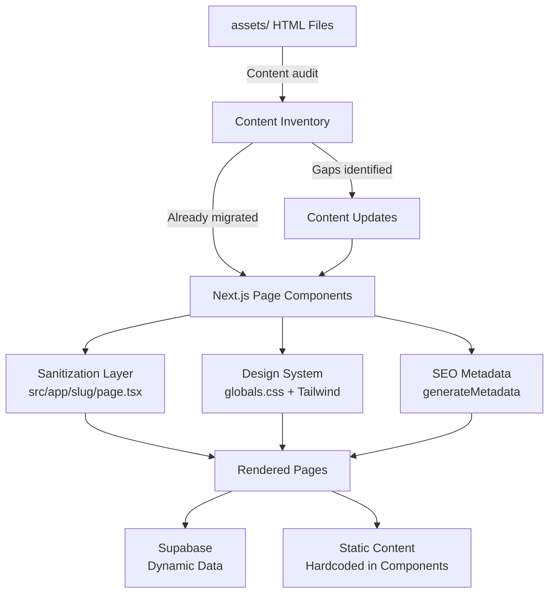
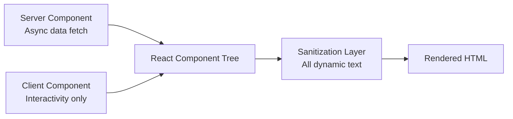
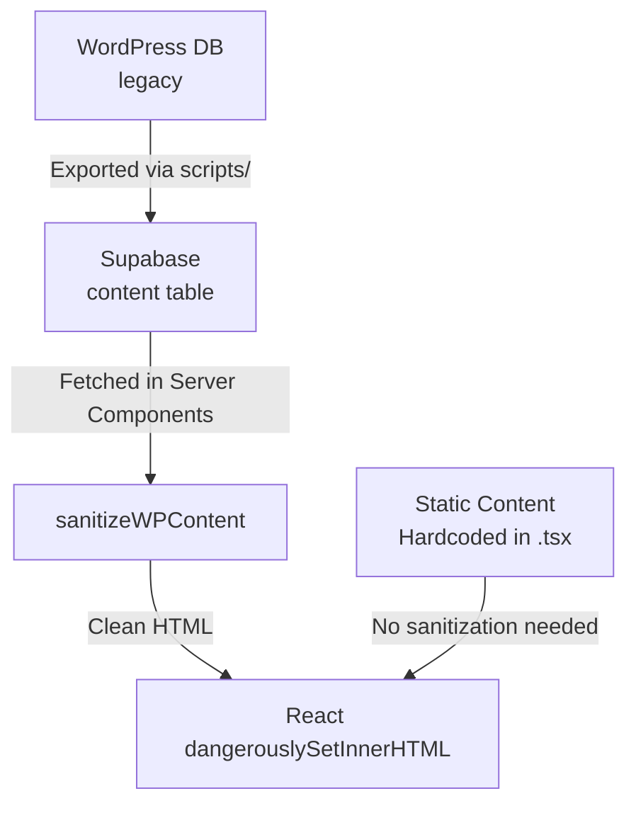

# Design Document: Assets Migration

## Overview

This document describes the technical design for migrating content from the legacy WordPress/Elementor HTML export files (in `assets/`) to the modern Next.js 16 headless e-commerce platform. The migration is largely complete at the infrastructure level — the Next.js app, Supabase backend, Stripe integration, and core page shells all exist. This design focuses on the remaining work: hardening each page's content fidelity, enforcing the Sensory Luxury design system consistently, strengthening the sanitization layer, and ensuring SEO metadata and accessibility are production-ready across all pages.

### Key Findings from Legacy HTML Analysis

The `assets/` HTML files are SingleFile browser exports of the live WordPress site. They contain:

- Massive inline CSS from WooCommerce, YITH Wishlist, Revolution Slider, Elementor, and the Freshio theme — none of which is relevant to the Next.js app.
- Spam-injected content in the JSON-LD schema blocks (casino, betting, crypto keywords) — already handled by `sanitizeWPContent` in `src/app/[slug]/page.tsx`.
- The actual page content (hero copy, testimonials, FAQ answers, partner descriptions, contact info) is already faithfully reproduced in the existing Next.js page components.
- No new images need to be sourced from the legacy HTML — all referenced images are already in `public/`.

The migration is therefore primarily a **hardening and consistency pass**, not a content extraction exercise.

---

## Architecture

The migration follows the existing Next.js 16 App Router architecture with no new infrastructure required.



### Component Rendering Model



Pages follow a strict split:
- **Server Components** for all data fetching (Supabase queries, static content rendering)
- **Client Components** only where interactivity is required (contact form, cart, wishlist)
- `revalidate = 60` on all data-fetching pages for ISR

---

## Components and Interfaces

### Page Component Map

| Legacy HTML File | Next.js Route | Component File | Type |
|---|---|---|---|
| `Home - Catch-22.html` | `/` | `src/app/page.tsx` | Server + Client (Suspense) |
| `Shop - Catch-22.html` | `/products` | `src/app/products/page.tsx` | Server |
| `Contact us - Catch-22.html` | `/contact` | `src/app/contact/page.tsx` | Client |
| `FAQs - Catch-22.html` | `/faqs` | `src/app/faqs/page.tsx` | Server |
| `Visit Our Partners - Catch-22.html` | `/partners` | `src/app/partners/page.tsx` | Server |
| `Catch-22 Catch-Snaps.html` | `/gallery` | `src/app/gallery/page.tsx` | Server |

### Sanitization Layer Interface

The `sanitizeWPContent` function in `src/app/[slug]/page.tsx` is the canonical sanitization implementation. A shared utility version should be extracted to `src/lib/sanitize.ts` so all pages can import it consistently.

```typescript
// src/lib/sanitize.ts

/**
 * Removes WordPress artifacts, spam content, and XSS vectors from HTML strings.
 * Safe to call on any user-generated or legacy-migrated content.
 */
export function sanitizeWPContent(html: string): string

/**
 * Sanitizes a plain text string (no HTML) — replaces spam keywords with "..."
 * Used for blog post titles and other non-HTML text fields.
 */
export function sanitizeText(text: string): string

/**
 * Returns true if the content contains suspicious patterns that warrant
 * manual review (excessive links, encoded strings, foreign spam patterns).
 */
export function hasSuspiciousContent(html: string): boolean
```

### SEO Metadata Interface

Every page must export a `generateMetadata` function conforming to Next.js `Metadata` type:

```typescript
// Pattern for all static pages
export const metadata: Metadata = {
  title: 'Page Title | Catch-22 New Zealand',
  description: 'Page-specific description...',
  openGraph: {
    title: 'Page Title | Catch-22 New Zealand',
    description: '...',
    url: 'https://catch-22.co.nz/page-slug',
    siteName: 'Catch-22',
    locale: 'en_NZ',
    type: 'website',
    images: [{ url: '/hero.jpg', width: 1200, height: 630, alt: '...' }],
  },
  twitter: {
    card: 'summary_large_image',
    title: 'Page Title | Catch-22 New Zealand',
    description: '...',
    images: ['/hero.jpg'],
  },
};
```

For dynamic pages (products, blog posts), `generateMetadata` is an async function that fetches from Supabase.

### Design System Token Interface

All components must use the CSS custom properties defined in `src/app/globals.css` via Tailwind utility classes:

| Token | CSS Variable | Tailwind Class | Value |
|---|---|---|---|
| Primary Lime | `--primary` | `bg-primary`, `text-primary`, `border-primary` | `#D1FF00` |
| Deep Secondary | `--secondary` | `bg-secondary`, `text-secondary` | `#0F172A` |
| Primary Dark | `--primary-dark` | `bg-primary-dark` | `#b8d600` |
| Accent | `--accent` | `bg-accent`, `text-accent` | `#dfb178` |

---

## Data Models

### Content Flow



### Supabase Content Table (relevant columns)

```typescript
interface ContentRow {
  id: number;
  title: string;        // Blog post / page title — sanitize with sanitizeText()
  slug: string;         // URL slug
  body: string;         // HTML content — sanitize with sanitizeWPContent()
  type: 'post' | 'page';
  status: 'publish' | 'draft';
  created_at: string;
}
```

### Supabase Products Table (relevant columns)

```typescript
interface ProductRow {
  id: number;
  name: string;
  slug: string;
  price: number;
  regular_price: number | null;
  sale_price: number | null;
  image_url: string | null;
  description: string;  // HTML — sanitize before rendering
  stock_status: 'instock' | 'outofstock';
}
```

### Spam Keyword Registry

The canonical spam keyword list is maintained in `src/lib/sanitize.ts`:

```typescript
export const SPAM_KEYWORDS = [
  'casino', 'slot', 'betting', 'gambling', 'poker', 'bingo', 'bonus', 'rtp',
  'vavada', '1xbet', 'mostbet', 'pin-up', 'vulcan', 'mahjong', 'sweet bonanza',
  'judi', 'genset', 'daftar', 'situs', 'gacor', 'olympus', 'sbobet',
  'spaceman', 'pragmatic', 'xanax', 'steroid', 'kasyno',
  'betsala', 'jeetcity', 'wazamba', 'moonwin', 'winspirit', 'loto',
  'apuesta', 'hellspincassino', 'candyspinz', 'wildsino', 'f12bet',
] as const;

export const TRUSTED_DOMAINS = [
  'catch-22.co.nz',
  'i0.wp.com', 'i1.wp.com', 'i2.wp.com',
  'supabase.co',
  'stripe.com',
  'hamandtys.com',
  'bayofplentyboathire.co.nz',
  'nzangler.co.nz',
  'seacleaners.org.nz',
  'givealittle.co.nz',
] as const;
```

---

## Correctness Properties

*A property is a characteristic or behavior that should hold true across all valid executions of a system — essentially, a formal statement about what the system should do. Properties serve as the bridge between human-readable specifications and machine-verifiable correctness guarantees.*

Property-based testing is applicable here because the sanitization layer is a pure transformation function with a large input space (arbitrary HTML strings), and the design system compliance checks are universal properties that should hold for all rendered components. We use [fast-check](https://github.com/dubzzz/fast-check) as the PBT library (TypeScript-native, well-maintained, works with Vitest).

### Property 1: Spam keyword removal is total

*For any* HTML string containing one or more words from the spam keyword list, after passing through `sanitizeWPContent`, the output SHALL contain none of those spam keywords.

**Validates: Requirements 2.6, 11.1, 11.2, 11.3**

### Property 2: Spam element removal removes the entire containing element

*For any* HTML `<p>`, `<div>`, or `<a>` element whose text content contains a spam keyword, after sanitization the entire element (including its tags) SHALL be absent from the output — not just the keyword text.

**Validates: Requirements 2.6, 11.3**

### Property 3: Trusted links are preserved, untrusted links are stripped

*For any* HTML string containing a mix of internal links (catch-22.co.nz), trusted external links (supabase.co, stripe.com, partner domains), and untrusted external links, after sanitization: all internal and trusted links SHALL be present in the output, and all untrusted external links SHALL be absent.

**Validates: Requirements 11.4**

### Property 4: JavaScript event handlers are always removed

*For any* HTML string containing one or more JavaScript event handler attributes (onclick, onerror, onload, onmouseover, etc.), after sanitization the output SHALL contain no `on[a-z]+` attributes.

**Validates: Requirements 11.6**

### Property 5: WordPress class names are eliminated

*For any* HTML string containing WordPress-specific class names (matching `wp-*`, `elementor-*`, `freshio-*`, `woocommerce`, `yith-*`), after passing through the artifact remover the output SHALL contain no strings matching those patterns.

**Validates: Requirements 3.1, 3.2, 3.3, 3.5**

### Property 6: Semantic structure is preserved through sanitization

*For any* HTML string containing semantic elements (`<h1>`–`<h6>`, `<p>`, `<ul>`, `<ol>`, `<li>`, `<a>` with trusted href), after sanitization those elements and their text content SHALL still be present in the output.

**Validates: Requirements 1.5, 2.1, 2.3**

### Property 7: Metadata title format is always correct

*For any* page title string, the `generateMetadata` function SHALL return a title matching the format `"{title} | Catch-22 New Zealand"` where `{title}` is the input string.

**Validates: Requirements 8.1, 8.2**

### Property 8: Images always have non-empty alt text

*For any* rendered page component that includes `` or Next.js `<Image>` elements, every image SHALL have a non-empty `alt` attribute.

**Validates: Requirements 10.2**

### Property 9: Sanitization is idempotent

*For any* HTML string, applying `sanitizeWPContent` twice SHALL produce the same result as applying it once — `sanitize(sanitize(x)) === sanitize(x)`.

**Validates: Requirements 4.1, 7.5**

---

## Error Handling

### Supabase Query Failures

All pages that fetch from Supabase must handle query errors gracefully:

```typescript
const { data, error } = await supabase.from('products').select('*');

if (error) {
  console.error('[PageName] Supabase error:', error.message);
  // Render graceful error state — never throw or crash
  return <ErrorState message="Failed to load content." />;
}
```

The `DealOfTheDay` and `LatestLogbookEntries` components on the home page already use `if (!data) return null` — this pattern should be consistent across all async components.

### Missing Images

Next.js `<Image>` components must always have a fallback strategy:

```typescript
// Use a placeholder when image_url is null
{product.image_url ? (
  <Image src={product.image_url} alt={product.name} fill />
) : (
  <div className="bg-slate-100 flex items-center justify-center h-full">
    <span className="text-slate-300 font-black uppercase text-xs tracking-widest">No Image</span>
  </div>
)}
```

### Sanitization Errors

`sanitizeWPContent` must never throw. All regex operations should be wrapped in try/catch:

```typescript
export function sanitizeWPContent(html: string): string {
  if (!html) return '';
  try {
    // ... sanitization logic
    return clean;
  } catch (err) {
    console.error('[sanitizeWPContent] Error:', err);
    return ''; // Fail safe — return empty rather than unsanitized content
  }
}
```

### Form Submission Errors

The contact form (`src/app/contact/actions.ts`) must return structured error responses:

```typescript
type ContactResult = 
  | { success: true }
  | { error: string };
```

The UI already handles `status === 'error'` with a visible error message — this pattern is correct and should be maintained.

---

## Testing Strategy

### Dual Testing Approach

This feature uses both unit/example-based tests and property-based tests. The sanitization layer is the primary target for PBT because it is a pure function with a large, varied input space where edge cases matter most (spam injection, XSS, link stripping).

### Property-Based Testing Setup

**Library**: [fast-check](https://github.com/dubzzz/fast-check) v3.x  
**Test runner**: Vitest (already configured in the project)  
**Minimum iterations**: 100 per property test  
**Location**: `src/lib/__tests__/sanitize.test.ts`

Each property test is tagged with a comment referencing the design property:

```typescript
// Feature: assets-migration, Property 1: Spam keyword removal is total
it('removes all spam keywords from HTML', () => {
  fc.assert(
    fc.property(
      fc.constantFrom(...SPAM_KEYWORDS),
      fc.string(),
      (keyword, surrounding) => {
        const html = `<p>${surrounding} ${keyword} ${surrounding}</p>`;
        const result = sanitizeWPContent(html);
        expect(result).not.toMatch(new RegExp(keyword, 'i'));
      }
    ),
    { numRuns: 100 }
  );
});
```

### Unit Tests

Unit tests cover specific examples and integration points:

- **Metadata format**: Each page's `generateMetadata` returns the correct title format
- **Design token presence**: Key page components render with `bg-primary`, `text-secondary`, `font-black`, `uppercase` classes
- **Supabase error states**: Pages render fallback UI when queries return errors
- **Form validation**: Contact form rejects empty fields and renders error messages
- **Semantic HTML**: Page components render `<main>`, `<section>`, `<h1>` elements

### Integration Tests

- **Products page**: Fetches products with `stock_status = 'instock'` filter
- **Blog/Logbook**: Fetches posts with `status = 'publish'` and `type = 'post'`
- **Contact form**: Server action inserts to Supabase and returns success

### Accessibility Checks

Manual testing with axe DevTools and keyboard navigation for:
- Focus order through navigation, forms, and interactive cards
- Screen reader announcements for dynamic content (cart updates, form submission)
- Color contrast ratios (Primary Lime #D1FF00 on Deep Secondary #0F172A achieves >7:1)

### Performance Verification

- Lighthouse CI on each page targeting LCP < 2.5s
- `next/image` `priority` prop on all above-the-fold images
- `Suspense` boundaries wrapping all async data-fetching components
- No client-side JavaScript on static pages (FAQs, Partners, Gallery)
