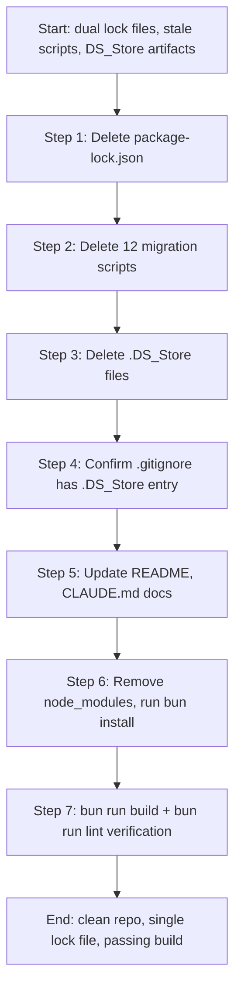

# Design Document: Project Cleanup

## Overview

This document describes the technical approach for cleaning up the Catch-22 Next.js 16 project. The cleanup has six concerns: migrating the package manager from npm to Bun, removing 12 one-time migration scripts, deleting OS/editor artifacts (`.DS_Store` files), confirming `.gitignore` coverage, updating developer documentation, and verifying the project builds cleanly under Bun.

The work is purely mechanical — no application logic changes, no new dependencies, no schema changes. The risk is low and every step is reversible via git. The execution order below is designed so that each step leaves the repository in a valid, committable state.

---

## Architecture

This is not a feature with a runtime architecture. The "system" being designed is the repository itself: its file layout, toolchain configuration, and documentation. The design therefore describes the target state of the repository after cleanup and the ordered sequence of operations to reach it.

The steps are ordered to keep the repository buildable at each stage. Documentation is updated before the Bun reinstall so that the final verification step confirms the documented commands actually work.

---

## Components and Interfaces

### 1. Lock File State

| File | Before | After |
|---|---|---|
| `bun.lock` | Present | Present (unchanged) |
| `package-lock.json` | Present | **Deleted** |
| `node_modules/` | npm-managed | **Regenerated by Bun** |

`package.json` is not modified. All existing scripts (`dev`, `build`, `start`, `lint`, `test`, `test:watch`) and all dependency entries remain exactly as-is.

### 2. Scripts Directory

**Delete (12 one-time migration scripts):**

| File | Reason |
|---|---|
| `scripts/migrate.mjs` | One-time WP→Supabase schema migration; contains hardcoded PostgreSQL connection string |
| `scripts/migrate_all_schemas.mjs` | One-time schema migration |
| `scripts/migrate_gallery_media.mjs` | One-time media migration |
| `scripts/migrate_internal_links.mjs` | One-time link rewrite |
| `scripts/migrate_media.mjs` | One-time media upload |
| `scripts/migrate_submissions.mjs` | One-time form submissions migration |
| `scripts/upload_all_media.mjs` | One-time bulk upload |
| `scripts/upload_final.mjs` | One-time final upload pass |
| `scripts/upload_products.mjs` | One-time product upload |
| `scripts/upload_users_orders.mjs` | One-time user/order migration |
| `scripts/cleanup_spam.mjs` | One-time spam cleanup pass |
| `scripts/deep_cleanup.mjs` | One-time deep cleanup pass |

**Retain (4 ongoing utility scripts):**

| File | Purpose |
|---|---|
| `scripts/health_check.mjs` | Production readiness check — queries Supabase for broken images and spam content |
| `scripts/sync_stripe.mjs` | Syncs Supabase products to Stripe (creates products/prices) |
| `scripts/verify_migration.mjs` | Queries all Supabase tables and reports row counts |
| `scripts/audit_images.mjs` | Audits Supabase Storage vs database image references |

All four retained scripts already use `dotenv` to load credentials from `.env.local`. No hardcoded credentials are present in any of them. No changes to these files are required.

### 3. Artifact Files

**Delete:**

| File | Location |
|---|---|
| `.DS_Store` | Repository root |
| `.DS_Store` | `.trunk/.DS_Store` |
| `.DS_Store` | `src/.DS_Store` |
| `.DS_Store` | `supabase/.DS_Store` |

**`.gitignore` status:** The `.gitignore` already contains a `.DS_Store` entry (line present in the current file). No change is needed. This is confirmed during the verification step.

### 4. Documentation Changes

**`README.md` — targeted line replacements:**

| Current text | Replacement |
|---|---|
| `Node.js 20+ or Bun` (Prerequisites) | `Bun 1.x` |
| `npm install` (Installation) | `bun install` |
| `# or` / `bun install` block | Remove the `# or` alternative; `bun install` is the only command |
| `npm run dev` (Development section) | `bun run dev` |

**`CLAUDE.md` — Quick Start section replacements:**

| Current text | Replacement |
|---|---|
| `npm run dev` | `bun run dev` |
| `npm run build` | `bun run build` |
| `npm run lint` | `bun run lint` |
| `npm run test` | `bun run test` |

**`AGENTS.md`:** No npm references are present in the current file. No changes required.

---

## Data Models

No data models are involved. The only "data" being modified is:

- **File system state**: which files exist at which paths
- **Text file content**: specific lines in `README.md` and `CLAUDE.md`
- **`.gitignore`**: already correct, no change needed

---

## Error Handling

### If `bun install` fails

Likely cause: a dependency in `package.json` has a version range that Bun cannot resolve, or a `trustedDependencies` entry (`unrs-resolver`) requires a post-install script that fails.

Resolution: check `bun install` output for the failing package, pin the version explicitly in `package.json`, and retry.

### If `bun run build` fails after reinstall

Likely cause: a package that was previously resolved by npm resolves to a different version under Bun, causing a type or API mismatch.

Resolution: compare the new `bun.lock` against the old `package-lock.json` for the failing package, pin the version in `package.json` to match the previously working version, and rebuild.

### If TypeScript errors appear after reinstall

Likely cause: `@types/*` packages resolved to a newer version under Bun.

Resolution: pin the affected `@types/*` package to the version that was previously installed.

### If `.DS_Store` reappears after deletion

This means the `.gitignore` entry is not being respected (e.g., the file was previously tracked). Resolution: run `git rm --cached .DS_Store` (and equivalents for subdirectory paths) to untrack the files, then commit. The `.gitignore` entry will then prevent future tracking.

---

## Testing Strategy

Property-based testing is **not applicable** to this feature. The cleanup consists entirely of file presence/absence checks, toolchain integration tests, and documentation content checks. None of these involve pure functions with meaningful input variation, and running 100+ iterations would add no value over a single check.

The appropriate testing strategy is a combination of smoke tests (single-pass assertions) and integration tests (running the actual toolchain commands).

### Smoke Tests — File System State

These are assertions that can be checked with a simple file-existence check after the cleanup steps are complete.

| Check | Expected result |
|---|---|
| `bun.lock` exists at repo root | Pass |
| `package-lock.json` does not exist at repo root | Pass |
| `scripts/` contains exactly 4 files | Pass |
| `scripts/health_check.mjs` exists | Pass |
| `scripts/sync_stripe.mjs` exists | Pass |
| `scripts/verify_migration.mjs` exists | Pass |
| `scripts/audit_images.mjs` exists | Pass |
| None of the 12 deleted migration scripts exist | Pass |
| `.DS_Store` absent at root, `.trunk/`, `src/`, `supabase/` | Pass |
| `.gitignore` contains `.DS_Store` entry | Pass |

### Smoke Tests — Documentation Content

| Check | Expected result |
|---|---|
| `README.md` contains `bun install` | Pass |
| `README.md` does not contain `npm install` | Pass |
| `README.md` contains `bun run dev` | Pass |
| `CLAUDE.md` does not contain `npm run` | Pass |
| `AGENTS.md` does not contain `npm run` | Pass |

### Example Test — Dependency Integrity

Read `package.json` and assert:
- All expected script keys are present: `dev`, `build`, `start`, `lint`, `test`, `test:watch`
- All expected production dependency names are present (spot-check: `next`, `react`, `@supabase/supabase-js`, `stripe`, `zustand`)
- No new dependency keys have been added

### Example Test — Credential Scan

Scan all files in `scripts/` for known credential patterns:
- No occurrence of `postgres://` with embedded credentials
- No occurrence of `sk_live_` as a literal string value (not an env var reference)
- No occurrence of `sk_test_` as a literal string value

### Integration Tests — Toolchain

These require a working Bun installation and are run manually or in CI after the cleanup steps:

| Command | Expected result |
|---|---|
| `bun install` | Exit code 0, `node_modules/` populated |
| `bun run build` | Exit code 0, `.next/` directory created |
| `bun run lint` | Exit code 0, zero ESLint errors |
| `bun run test` | Exit code 0, existing vitest tests pass |

The existing test suite (`src/lib/__tests__/sanitize.test.ts`) uses vitest and fast-check and must continue to pass after the Bun reinstall. This is the primary regression guard for the application logic.
